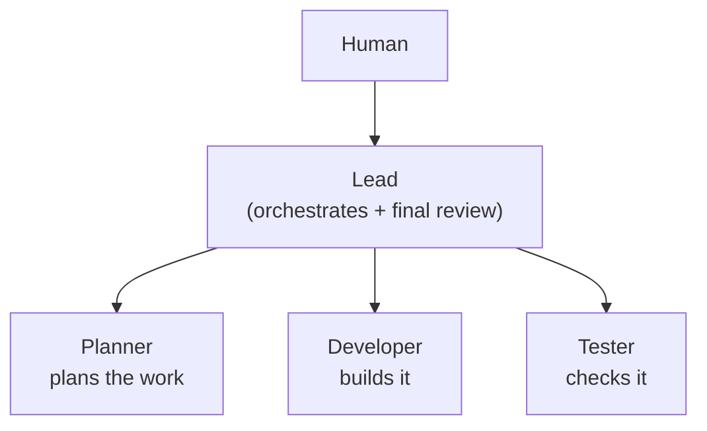
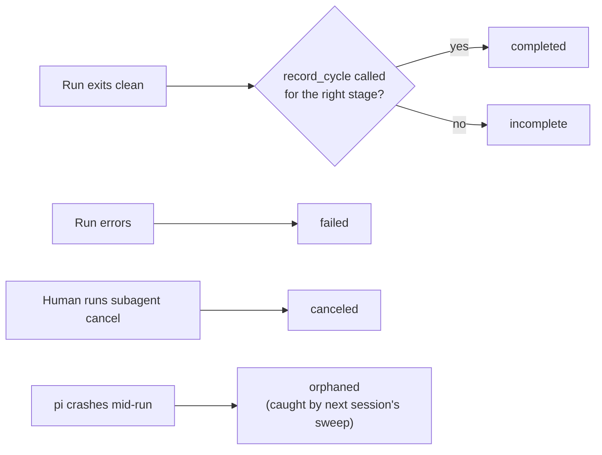

<div align="center">

# Jay Pi

**A process-engineering layer for agentic development, built on [pi](https://github.com/earendil-works/pi-coding-agent).**
A local, evidence-first process engine for human-approved agent work.

[](LICENSE)
[](https://github.com/earendil-works/pi-coding-agent)
[](#install)
[](#why-the-structured-db-writes-and-the-non-completed-run-statuses)

</div>

A role-based subagent harness for pi: a **Lead** agent that orchestrates
planning, implementation, and checking across three subagent roles
(**Planner**, **Developer**, **Tester**) and performs the final review
itself, with structured SQLite capture at every stage (written through a
tool call, not freehand SQL — see below), a human-in-the-loop review
pattern ("Grilling Discipline") instead of single yes/no gates, and an
optional, gated write-back to whatever external tracker you use.

Jay Pi combines an `AGENTS.md` operating contract, pi extensions and role prompts,
and a reusable local engine shared by the pi integration and standalone CLI.
The existing pi installation path remains available; the offline demo needs
only Node 24+ and does not install or authenticate an agent provider.

The process — plan, approve, implement, verify, review — is the actual
product. Swap the model, or swap pi for another agent entirely, and the
same gates, the same verification, the same audit trail still hold; the
shared engine makes those checks explicit and auditable at supported entry points. These workflow checks are not an OS sandbox.

**Jump to:** [How it fits together](#how-it-fits-together) ·
[What's in here](#whats-in-here) ·
[Install](#install) ·
[Security posture](#security-posture--read-before-you-install) ·
[Credits](#credits)

## Start here: an offline working cycle

Requires **Node 24+**. In this checkout:

```sh
npm ci --ignore-scripts
npm test
npm run demo
node bin/jay-pi.mjs doctor
```

The demo uses **deterministic local fixture subprocesses, not an AI model**.
It runs Planner → synthetic fixture approval → Developer → Tester → Lead,
then demonstrates missing/wrong-stage evidence, provider failure, and
cancellation. It uses the same runtime and real SQLite records as the pi
integration. The printed temporary workspace is retained for inspection.
No account, credential, network request, or real human approval is exercised.

`doctor` checks prerequisite presence without launching providers. Installing
root development dependencies does not install the nested record-cycle MCP
server dependencies. For live Claude/Codex integration, install those separately:

```sh
npm ci --ignore-scripts --prefix extensions/mcp/record-cycle-server
```

### CLI: inspect first, then deliberately execute

```sh
node bin/jay-pi.mjs list --cwd /path/to/project
node bin/jay-pi.mjs status RUN_ID --cwd /path/to/project
node bin/jay-pi.mjs plan --cwd /path/to/project
node bin/jay-pi.mjs approve --cwd /path/to/project
node bin/jay-pi.mjs run --role planner --runner pi --task "Plan this change" --cwd /path/to/project
```

Replace `RUN_ID` and project paths with actual values. `approve` displays the
latest plan and requires an exact confirmation in an interactive terminal;
there is no unattended `--yes` bypass. A plan revision invalidates approval.
Live `run` commands invoke your installed provider and may incur costs. They
are **not** part of the offline quickstart. Developer requires an approved
plan; writing permissions are a separate choice (`--allow-edits` requests
`workspace-write`, subject to the provider's capabilities). Consult `--help`
for result/events/recovery, timeouts, explicit context continuation, and JSON
output. Recovery marks abandoned runs; it never automatically replays work.

### One engine, two entry points

`extensions/harness/runtime.mjs` exports `createHarness({ cwd })`. Its
`start(...)`, `list()`, `get(runId)`, `cancel(runId)` and `recover()` operations
are shared by the CLI and pi lifecycle extension. `start` returns a run ID and
completion promise. SQLite stage records remain in `data/`; versioned run
snapshots and lifecycle events are inspectable in `data/subagent-runs/`.
Continuation via `previousRunId` transfers prior output as context, not a
provider session resume or an exactly-once retry guarantee.

### Provider support and verification

| Runner | Integration | Default boundary | Verification here |
|---|---|---|---|
| `pi` | Existing JSON CLI integration, now using shared engine | Trusted local provider process; tool selection is not an OS sandbox | Offline contracts/fixtures; authenticated execution not validated |
| `claude-cli` | Stream-JSON CLI adapter and record-cycle MCP | Restricted tools; no dangerous permission-bypass mode | Offline contracts/fixtures; authenticated execution not validated |
| `codex-cli` | Experimental JSON CLI adapter and record-cycle MCP | Requests provider read-only sandbox by default; host MCP runs outside it | Offline contracts/fixtures; authenticated execution not validated |
| `mock` | Deterministic fixture subprocess | Temporary local demo/test workspace | Not an LLM integration |

Read-only is the default permission profile; workspace mutation requires an
explicit `workspace-write` request. Provider capabilities differ: tool policy
is not equivalent to an OS sandbox, and provider permissions still apply.
Unsupported options must fail rather than silently relax restrictions. No
claim of production readiness, live account validation, or universal provider
compatibility is made.

[Architecture](docs/architecture.md) · [Migration notes](docs/migration.md) · [Morning walkthrough](docs/morning-walkthrough.md) · [Feature coverage & live checklist](docs/feature-coverage.md)

## How it fits together



In order: Planner plans, Developer implements (only after `approve_plan`
has fired), Tester checks, Lead reviews the whole cycle. Each role hands
its result back to Lead automatically ("auto-handoff") the moment it
finishes — Lead never polls for it. Each role also has exactly one DB it
writes to and one external-sink section it offers — see the table below,
not this diagram, for that mapping.

Each role is a separate top-level `pi` (or `claude`) process, not a nested
sub-agent call. This limits shared conversational failures, but does not guarantee
that work survives controller or machine termination. Every
stage write goes through `record_cycle`, which `lifecycle-subagent` checks
against the actual message trace, not the subagent's own account of it:



## What's in here

- **`AGENTS.md`** — the operating contract. Defines the four roles, the
  plan → implement → check → review lifecycle, SQLite capture layout, and the
  human approval gates ("Grilling Discipline": one question at a time, a
  recommended default attached to each, no bundling).
- **`agents/`** — the three subagent role prompts (Planner/Developer/Tester),
  loaded by pi's `subagent` tool.
- **`extensions/`**
  - `lifecycle-subagent/` — registers the `subagent` tool: runs a role
    (in the background by default) either as another pi process or, via
    `runner: "claude-cli"`, as a `claude -p` invocation — useful for bridging
    to Claude-Code-native skills that pi's own subagent tool can't spawn.
    Reports a run's outcome as `completed`, `incomplete`, `failed`,
    `canceled`, or `orphaned` (see `cycle-records.ts` below for what
    `incomplete` means; `canceled` is a plain human-initiated
    `subagent cancel`, not a bug; `orphaned` means the process running it
    died mid-run — e.g. a `pi` crash — and was caught by a startup sweep in
    a later session, not that the work itself failed), and supports scoping
    each child process's
    environment through an explicit allowlist — see "Security posture" below.
  - `cycle-records.ts` — registers the `record_cycle` tool: the actual,
    machine-verified way Planner/Developer/Tester write their DB records,
    replacing freehand `sqlite3` calls the model used to construct itself.
    `lifecycle-subagent` checks whether this tool was actually called (and
    for the right stage — a Developer can't attribute a row to Tester by
    passing the wrong stage) before reporting a run `completed`; a
    subagent's own closing message is never trusted as proof the DB record
    exists.
  - `mcp/record-cycle-server/` — a standalone MCP server exposing that same
    `record_cycle` capability to Claude-CLI-routed subagents, which run as a
    bare `claude -p` subprocess with no path back into any pi-registered
    tool. `lifecycle-subagent` wires it in automatically via `--mcp-config`
    (confined with `--strict-mcp-config` so a subagent run never inherits
    your own configured MCP servers) whenever a role's runner is
    `claude-cli` — no setup needed beyond `npm install` in that directory
    (done for you by `install.sh`).
  - `subagent-status.ts` — a live status ticker (2–3 lines, fixed height)
    shown above the editor while a background subagent runs, so the lead
    session isn't a black box while something else works.
  - `agent-session-profile/` — lets you pin a runner/model/thinking-level
    per role, resolved across session → project → global scope, so you
    aren't re-answering "which model for Developer?" every session.
  - `external-sink-gate.ts` — a generic version of "never write to an
    external system without a human seeing the literal payload first."
    Nothing is gated until you configure it — see `config/external-sink.example.json`.
  - `grill.ts` — registers the `grill` tool: code-enforces the Grilling
    Discipline pattern above instead of leaving it as a prose convention.
    `recommended` is a schema-required field (the call fails validation
    without one), and it blocks on the human's actual answer, so "one
    question at a time" holds by construction, not by discipline. Requires
    an interactive session — refuses cleanly from a background subagent.
  - `plan-approval.ts` — registers the `approve_plan` tool, and
    `lifecycle-subagent` refuses to spawn Developer until the human has
    called it against the latest `approach.db` row. Tied to a specific row
    id, not "approval happened at some point" — a plan revision after
    approval isn't silently still authorized. `skipApprovalGuard` is deprecated and refused: review and approve the
    current plan instead. Workspace edits additionally require explicit permission.
  - `agents-md-freshness.ts` — warns if a resumed/forked session's context
    predates the current `AGENTS.md`, so a stale operating contract doesn't
    silently keep running.
  - `tokens-per-second.ts` — a small footer stat.
  - `tui-console-guard.ts` — keeps raw `console.log/warn/error` output from
    other packages off the screen while the TUI is up (pi only intercepts
    console output in non-interactive modes, so a package that prints an OAuth
    URL or a connect error lands under the editor bar and never gets repainted).
    Output goes to `~/.pi/agent/logs/console.log`; login URLs still show as a
    normal notification and error bursts collapse into one summary notice.
  - `jev-parallel-check.ts` — an optional second opinion on Tester's verdict
    from [TypeSafe's Jev](https://typesafe.ai), a calibrated classifier
    rather than a chat model. Fully inert until you set `JEV_API_KEY` — see
    "Optional: Jev cross-check" below.
- **`patches/`** — a self-healing patch system for hand-fixing bugs in the
  installed `pi-coding-agent` npm package that would otherwise get wiped by
  every pi upgrade. Content-anchored (not line-diff-based), so it survives pi
  changing its own build layout. Ships one real fix today: a CommonMark
  soft-line-break bug in `pi-tui`'s Markdown renderer.
- **`config/`** — `*.example.json` templates for `settings.json`,
  `models.json`, `mcp.json`, and `external-sink.json`.
- **`docs/model-provider-setup.md`** — a walkthrough for wiring a self-hosted
  OpenAI-compatible reasoning model (e.g. a vLLM-served Qwen3 deployment)
  into pi, including a real gotcha around where the "enable thinking" flag
  actually needs to live in the request body.
- **`deck/`** — a 28-slide "Harness Engineering" deck walking through this
  repo's actual design (payload-vs-narration, the five run statuses,
  Grilling Discipline, the Plan Approval Gate, the Jev cross-check as a
  worked extension example). Self-contained: open `deck/index.html` in a
  browser, no build step.

## Why the structured DB writes and the non-`completed` run statuses

If you're running smaller/self-hosted models alongside stronger hosted ones,
prose-only procedural instructions ("write your record to the DB when
you're done") are a real drift surface — a weaker model can exit cleanly
while claiming success without the write ever happening correctly, and
nothing catches it. Two things here exist specifically to close that gap:

- **`record_cycle`** makes the DB write itself the source of truth, not the
  model's account of the write. A subagent's closing chat message and its
  actual recorded output are allowed to disagree; only the latter matters.
- **The `incomplete` status** is what `lifecycle-subagent` reports when a
  run exits clean but never made a successful `record_cycle` call — an
  honest "this may not have actually happened" signal instead of a silent
  false `completed`. It isn't automatically a failure (some tasks legitimately
  don't touch the DB) — it's a prompt for Lead to check before trusting the run.

Every `record_cycle` write, `grill` exchange, and `approve_plan` call also
appends one line to `data/history.jsonl` — a flat, append-only, cross-stage
timeline of everything that happened in a cycle, in order. The per-stage DBs
stay the source of truth for each stage's own record; this is for "what
happened, across the whole cycle" as one `tail`, not a four-way join.

## Install

```sh
git clone https://github.com/JayMandava/jay-pi.git
cd jay-pi
./install.sh
```

The optional pi installer installs/updates pi unless explicitly skipped, checks runtime prerequisites, copies `extensions/`, `agents/`, and `patches/` into
`~/.pi/agent/` (always fresh — that's this repo's actual content), writes
`settings.json` / `models.json` / `mcp.json` / `~/AGENTS.md` **only if they
don't already exist** (never overwrites your own config), runs
`self-heal.sh check` + `reapply.sh` automatically, and finishes by offering
to launch `pi` right there.

Credentials are the one thing it deliberately doesn't try to automate —
`pi` already has a good `/login` flow (Claude Pro/Max, ChatGPT Plus/Pro,
GitHub Copilot, OpenRouter, and more) and standard `ANTHROPIC_API_KEY`/
`OPENAI_API_KEY`-style env vars for API-key providers, so the script just
hands off to that instead of reinventing it. Edit `~/.pi/agent/models.json`
for the models you actually have (see `docs/model-provider-setup.md` if
you're wiring up a self-hosted model), then either export a key or run
`/login` inside `pi`.

Skip specific steps with `PI_HARNESS_SKIP_PI_INSTALL=1` (don't touch your
pi install) or `PI_HARNESS_SKIP_LAUNCH=1` (don't offer to launch `pi` at
the end) — useful on a re-run or a pinned setup.

Prefer to do it by hand instead of running the script? Everything it does is
short and readable — read `install.sh` directly.

### Optional: gating writes to an external tracker

If your team keeps project context in Notion (or Linear, Confluence, etc.)
and wants Planner/Developer/Tester/Lead to be able to write status updates
back there — but only after a human has seen the literal draft — copy
`config/external-sink.example.json` to `~/.pi/agent/external-sink.json` and
edit it to list the write-tool names for whatever MCP server you're using.
Nothing is gated until this file exists.

### Optional: Jev cross-check

`extensions/jev-parallel-check.ts` asks [TypeSafe's Jev](https://typesafe.ai)
— a calibrated Choice/Score/Noul classifier, not a chat model — three
independent yes/no questions (plan fidelity, drift, risk coverage) about
Developer's diff every time Tester writes its `feedback` record, built only
from the approved plan and a live `git diff`, never from Tester's own
verdict. The result gets appended to that same `record_cycle` tool result
(so Tester restates it verbatim in its report) and logged durably to
`data/jev-parallel-check.db` — purely informational, it never blocks,
gates, or changes Tester's already-recorded verdict.

This does nothing until you configure it, and costs nothing if you never
do:
1. Get an API key at [console.typesafe.ai](https://console.typesafe.ai).
2. Set `JEV_API_KEY` in your environment (or add `JEV_API_KEY=...` to
   `~/.pi/.env`).

No key set → the extension silently no-ops on every feedback cycle. Same
for a timed-out or failing request (8s timeout) — Tester's own run is never
affected either way.

### Optional: scoping subagent environments

The shared runtime passes a minimal operating-system environment plus names
explicitly supplied in `envAllowlist`. Unrelated shell secrets are not copied
by default. Configure provider-specific variables deliberately; do not use
blanket inheritance to fix authentication failures. `HOME` remains available
for provider login/configuration, so environment filtering alone does not
isolate credentials stored on disk.

## Security posture — read before live use

This is a **trusted-local workflow controller**, not hostile-agent isolation.

- Approval and stage-proof checks are enforced through supported runtime
  entry points. Someone with filesystem/code execution access can alter
  records or call trusted host APIs; SQLite and JSONL are not tamper-proof.
- No adapter enables `--dangerously-skip-permissions`. Read-only is the
  default profile; `--allow-edits` is an explicit workspace-write request,
  not permission to publish, deploy, or access external services.
- Pi is a local process, not an OS sandbox. Claude tool restrictions are not
  an OS sandbox either. Codex requests its provider sandbox, but the
  record-cycle MCP server is a host process with narrowly scoped writes.
- Provider authentication/configuration can still be accessible through
  `HOME`. Use a separate OS account/container if that trust level is too broad.
- The external-sink gate covers configured calls through its pi hook. It
  cannot intercept arbitrary HTTP requests, shell commands, or other clients.
- Recovery records abandoned work without re-executing it. Review partial
  files and records before deciding to retry; side effects are not exactly-once.
- Run transcripts and stage records can contain sensitive task content.
  Treat `data/` as private local state; do not commit or publish it.

Core cycle/approval storage uses Node 24 built-in SQLite and does not require
the `sqlite3` executable. The optional Jev cross-check still requires the `sqlite3` executable,
remains opt-in, and can incur external API costs. Do not interpret a successful offline fixture run as a live provider
security or integration certification.

## Credits

- Built on [pi](https://github.com/earendil-works/pi-coding-agent) by
  [@earendil-works](https://github.com/earendil-works).
- The `PR Review Rule` in `AGENTS.md` references
  [ponytail](https://github.com/DietrichGebert/ponytail) by
  [@DietrichGebert](https://github.com/DietrichGebert) for an
  over-engineering/complexity review pass — install it as a pi package if you
  want that step.
- The `orphaned` run status was borrowed from a comparison against
  [SenteLabsAI/OpenExecutive](https://github.com/SenteLabsAI/OpenExecutive)
  — a different kind of multi-agent system, but its scheduler has a
  boot-time sweep for exactly this class of bug (a run stuck mid-flight
  after a crash).
- `grill.ts`'s pattern (interview one question at a time until reaching
  shared understanding, no bundling) is [Matt Pocock](https://github.com/mattpocock)'s
  [`grill-me` skill](https://github.com/mattpocock/skills/blob/main/skills/productivity/grill-me/SKILL.md)
  from [mattpocock/skills](https://github.com/mattpocock/skills) — this
  harness's own Grilling Discipline predates it, but `grill.ts` specifically
  was written after seeing that skill code-shaped the same idea.
- `plan-approval.ts` (the Developer mutation guard) and the
  `data/history.jsonl` audit ledger were borrowed from a comparison against
  [CraftsMan-Labs/HarnessEngineeringWorkshop](https://github.com/CraftsMan-Labs/HarnessEngineeringWorkshop)'s
  `dsh-software-factory` plugin — specifically its ticket-state mutation
  guard and its flat append-only `history.jsonl` ledger.
- `extensions/jev-parallel-check.ts` integrates [Jev](https://typesafe.ai)
  by [TypeSafe](https://console.typesafe.ai) — a calibrated Choice/Score/
  Noul classifier used here as an optional, independent second opinion on
  Tester's verdict. Fully optional; see "Optional: Jev cross-check" above.

## License

MIT — see `LICENSE`.
